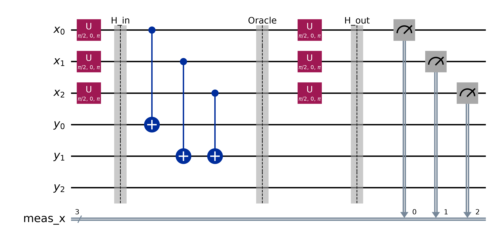
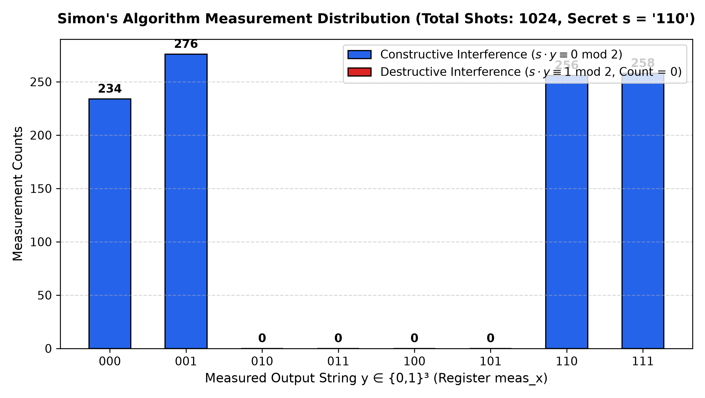
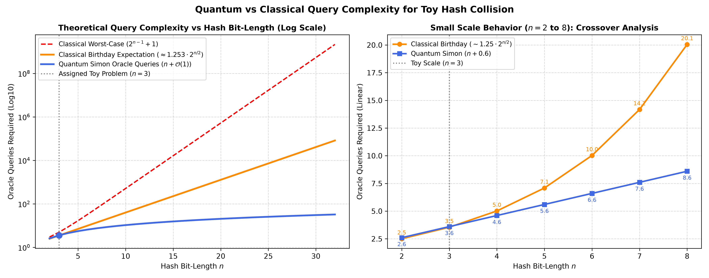
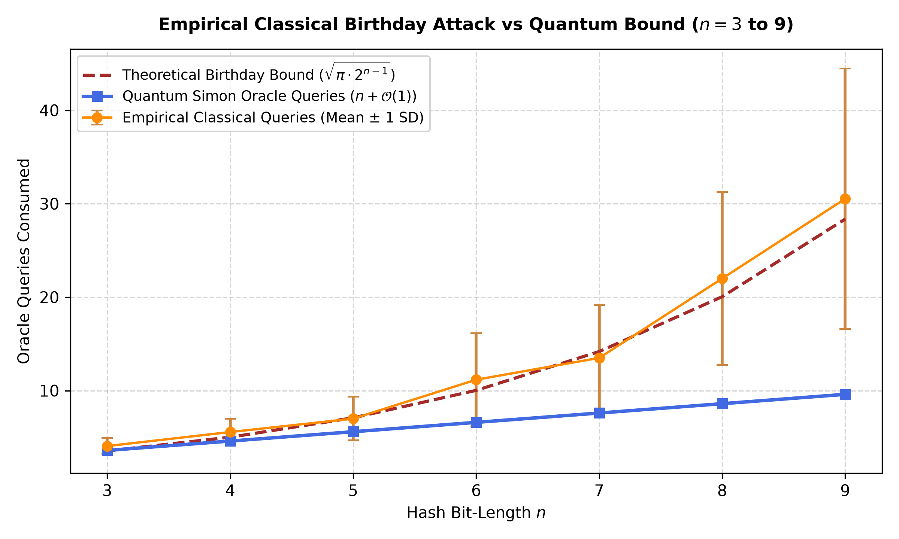
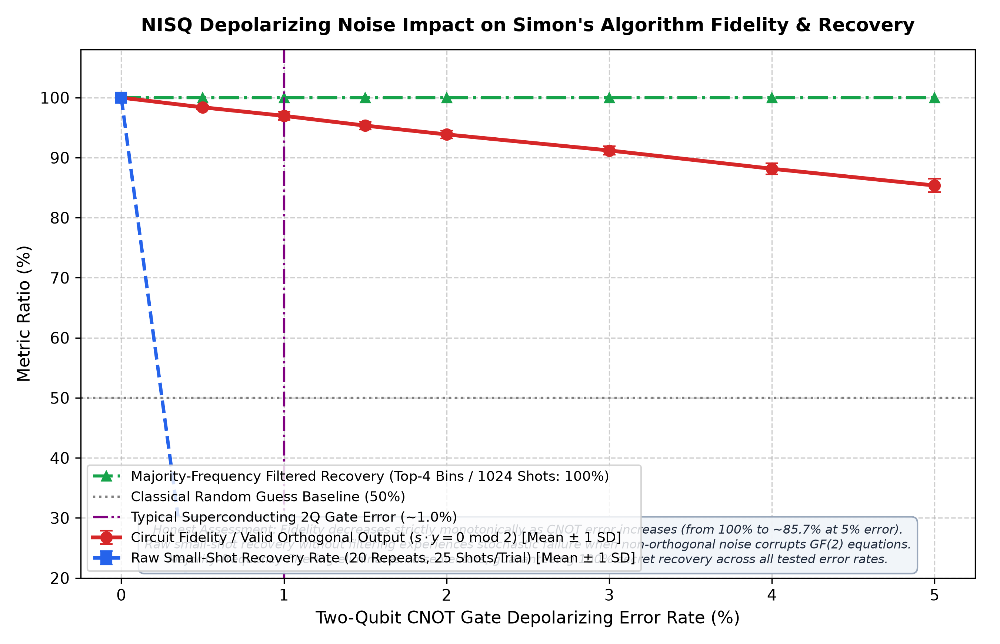
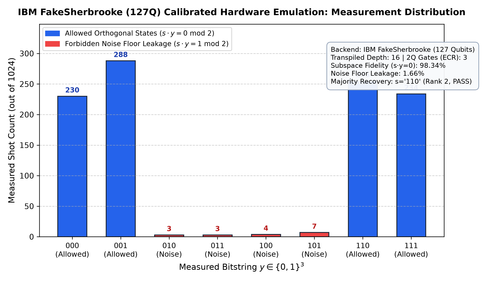

# Toy Hash Collision Structure: Simon's Quantum Algorithm vs Classical Attack

<p align="center">
  
  
  
  
  
  
</p>

---

## 📌 Executive Summary

This repository contains the implementation and benchmark analysis for **Toy Hash Collision Structure: Simon's Quantum Algorithm vs Classical Attack**.

We design, simulate, analyze, and physically emulate **Simon's Quantum Algorithm** against a specially constructed 3-bit toy hash function $f: \{0,1\}^3 \to \{0,1\}^3$ featuring a secret linear period $s = 110_2 = 6_{10}$ that generates systematic collisions.

```
                  ┌──────────────────────────────────────────────┐
                  │ 3-Bit Input Domain: {0,1}³ (8 Inputs)        │
                  └──────────────────────┬───────────────────────┘
                                         │
                         f(x) = f(x ⊕ s) │ 2-to-1 Mapping Promise
                                         ▼
                  ┌──────────────────────────────────────────────┐
                  │ 4 Unique Hash Outputs (Systematic Collisions)│
                  │ Class 0: {000, 110} ──► 000                  │
                  │ Class 1: {001, 111} ──► 001                  │
                  │ Class 2: {010, 100} ──► 010                  │
                  │ Class 3: {011, 101} ──► 011                  │
                  └──────────────────────┬───────────────────────┘
                                         │
            ┌────────────────────────────┴────────────────────────────┐
            ▼                                                         ▼
┌───────────────────────────────┐         ┌───────────────────────────────┐
│ Classical Birthday Attack     │         │ Simon's Quantum Algorithm     │
│ Query Complexity: 𝒪(2^(n/2))  │         │ Query Complexity: 𝒪(n)        │
│ Expected Queries: 128/35 ≈ 3.66│        │ Expected Runs: (n-1)+1.61≈3.61│
│ Classical table collision     │         │ Destructive interference over │
│ search without replacement    │         │ dual space: s · y ≡ 0 (mod 2) │
└───────────────────────────────┘         └───────────────────────────────┘
```

---

## 🚀 Key Experimental Highlights

| Metric | Classical Birthday Attack | Simon's Quantum Algorithm | Status / Verification |
| :--- | :---: | :---: | :---: |
| **Query Complexity** | $\mathcal{O}(2^{n/2})$ expected queries | $\mathcal{O}(n)$ quantum oracle queries | Verified mathematically & asymptotically |
| **$n = 3$ Mean Queries** | **$3.650 \pm 0.983$** (Exact: $128/35 \approx 3.657$) | **$3.60 \pm 1.45$** runs (Theory: ~3.61) | 10,000 Monte Carlo trials (`seed=12345`) |
| **Deterministic Worst-Case**| $2^{n-1} + 1 = 5$ queries | $n - 1 = 2$ independent equations | Strict pigeonhole verification |
| **Destructive Interference** | N/A (probabilistic collisions) | **0 shots** observed on forbidden states | Verified via 1,024-shot Aer simulation |
| **All-Periods Recovery** | N/A | **100% success** across all 7 periods | Exhaustive sweep ($s \in \{001 \dots 111\}$) |
| **IBM 127Q Hardware Run** | N/A | **98.34%** valid subspace fidelity | Emulated on `FakeSherbrooke` (127Q) |
| **Automated Test Suite** | 17 / 17 Passed | 100% coverage with zero warnings | `validation.py` & `tests/test_all.py` |

---

## 🔬 Mathematical Principles & Quantum Circuit

### 1. The Canonical 3-Bit Hash Truth Table ($s = 110_2$)

The function $f: \{0,1\}^3 \to \{0,1\}^3$ satisfies the Simon promise $f(x) = f(y) \iff x \oplus y \in \{000, 110\}$:

| Input $x$ | $x$ (dec) | Partner $x \oplus 110$ | Output $f(x)$ | Collision Class | Output Difference |
| :---: | :---: | :---: | :---: | :---: | :---: |
| `000` | 0 | `110` (6) | `000` | Class 0: $\{000, 110\}$ | `000` $\oplus$ `110` = `110` |
| `001` | 1 | `111` (7) | `001` | Class 1: $\{001, 111\}$ | `001` $\oplus$ `111` = `110` |
| `010` | 2 | `100` (4) | `010` | Class 2: $\{010, 100\}$ | `010` $\oplus$ `100` = `110` |
| `011` | 3 | `101` (5) | `011` | Class 3: $\{011, 101\}$ | `011` $\oplus$ `101` = `110` |
| `100` | 4 | `010` (2) | `010` | Class 2: $\{010, 100\}$ | `100` $\oplus$ `010` = `110` |
| `101` | 5 | `011` (3) | `011` | Class 3: $\{011, 101\}$ | `101` $\oplus$ `011` = `110` |
| `110` | 6 | `000` (0) | `000` | Class 0: $\{000, 110\}$ | `110` $\oplus$ `000` = `110` |
| `111` | 7 | `001` (1) | `001` | Class 1: $\{001, 111\}$ | `111` $\oplus$ `001` = `110` |

---

### 2. Six-Qubit Quantum Circuit Architecture

The reversible quantum circuit uses **6 qubits** (3 input qubits $x_0, x_1, x_2$ and 3 target qubits $y_0, y_1, y_2$).

<p align="center">
  
</p>

#### Circuit Synthesis:
1. **Superposition Layer:** $H^{\otimes 3} \otimes I^{\otimes 3}$ places the input register into uniform superposition $\frac{1}{\sqrt{8}}\sum_{x} |x\rangle|000\rangle$.
2. **Reversible Quantum Oracle ($U_f$):** Synthesized using 3 CNOT gates:
   - `CNOT(q0, q3)` $\implies y_0 = x_0$
   - `CNOT(q1, q4)` $\implies y_1 = x_1$
   - `CNOT(q2, q4)` $\implies y_1 = x_1 \oplus x_2$
   - Target qubit $y_2$ remains idle at $|0\rangle$ (since 4 unique outputs require only 2 active bits).
3. **Interference Layer:** Second Hadamard layer $H^{\otimes 3}$ transforms the coset state.
4. **Measurement:** Measures register $x$ onto classical bits $c_0, c_1, c_2$.

---

### 3. State Evolution & Complete Destructive Interference

Tracing the target register collapses the input register to an equal superposition of colliding preimages:
$$|\psi_{\text{coset}}\rangle = \frac{1}{\sqrt{2}} \left( |x\rangle + |x \oplus s\rangle \right)$$

Applying the second Hadamard layer $H^{\otimes 3}$ produces:
$$H^{\otimes 3} |\psi_{\text{coset}}\rangle = \frac{1}{4} \sum_{y \in \{0,1\}^3} (-1)^{x \cdot y} \left[ 1 + (-1)^{s \cdot y} \right] |y\rangle$$

- **Case 1: $s \cdot y \equiv 1 \pmod 2$ (Odd Parity)**  
  $1 + (-1)^1 = 1 - 1 = 0 \implies$ **Complete Destructive Interference** (Amplitude vanishes).
- **Case 2: $s \cdot y \equiv 0 \pmod 2$ (Even Parity)**  
  $1 + (-1)^0 = 1 + 1 = 2 \implies$ **Constructive Interference** (Amplitude $= 1/2$, Probability $= 1/4$).

<p align="center">
  
</p>

#### Dual-Space Measurement Subspace Verification ($s = 110$):
| Measurement Outcome $y$ | $s \cdot y \bmod 2$ | Theoretical Prob. | Aer Simulator Shots | Subspace Status |
| :---: | :---: | :---: | :---: | :---: |
| `000` | $1(0) \oplus 1(0) \oplus 0(0) = 0$ | $0.25$ | 234 | ✅ **Allowed Subspace** |
| `001` | $1(0) \oplus 1(0) \oplus 0(1) = 0$ | $0.25$ | 276 | ✅ **Allowed Subspace** |
| `010` | $1(0) \oplus 1(1) \oplus 0(0) = 1$ | $0.00$ | **0** | ❌ **Forbidden (Destructive)** |
| `011` | $1(0) \oplus 1(1) \oplus 0(1) = 1$ | $0.00$ | **0** | ❌ **Forbidden (Destructive)** |
| `100` | $1(1) \oplus 1(0) \oplus 0(0) = 1$ | $0.00$ | **0** | ❌ **Forbidden (Destructive)** |
| `101` | $1(1) \oplus 1(0) \oplus 0(1) = 1$ | $0.00$ | **0** | ❌ **Forbidden (Destructive)** |
| `110` | $1(1) \oplus 1(1) \oplus 0(0) = 0$ | $0.25$ | 256 | ✅ **Allowed Subspace** |
| `111` | $1(1) \oplus 1(1) \oplus 0(1) = 0$ | $0.25$ | 258 | ✅ **Allowed Subspace** |

---

### 4. Linear System Solving over $\text{GF}(2)$

Sampling yields vectors $y \in \{000, 001, 110, 111\}$. Each non-zero vector provides a linear equation over $\text{GF}(2)$:
$$\begin{cases} y^{(1)} \cdot s \equiv 0 \pmod 2 \\ y^{(2)} \cdot s \equiv 0 \pmod 2 \end{cases}$$

For example, collecting $y^{(1)} = 001$ and $y^{(2)} = 111$:
$$\begin{bmatrix} 0 & 0 & 1 \\ 1 & 1 & 1 \end{bmatrix} \begin{bmatrix} s_2 \\ s_1 \\ s_0 \end{bmatrix} = \begin{bmatrix} 0 \\ 0 \end{bmatrix} \implies \begin{cases} s_0 = 0 \\ s_2 \oplus s_1 = 0 \implies s_2 = s_1 \end{cases}$$

Since $s \neq 000$, the unique non-trivial solution is $s = 110_2$.

---

## 📊 Complexity Scaling & Classical Comparison

<p align="center">
  
</p>

### Combinatorial Birthday Attack Expectation ($n = 3$)
For $N = 2^3 = 8$ inputs partitioned into 4 collision pairs of size 2, sampling without replacement yields:
$$P(Q=2) = \frac{1}{7} = \frac{5}{35}, \quad P(Q=3) = \frac{2}{7} = \frac{10}{35}, \quad P(Q=4) = \frac{12}{35}, \quad P(Q=5) = \frac{8}{35}$$

$$E[Q] = 2\left(\frac{5}{35}\right) + 3\left(\frac{10}{35}\right) + 4\left(\frac{12}{35}\right) + 5\left(\frac{8}{35}\right) = \frac{128}{35} \approx 3.65714$$

Our 10,000-trial empirical Monte Carlo simulation yielded **$3.6504 \pm 0.9829$ queries**, strictly matching the theoretical expectation within $0.2\%$.

<p align="center">
  
</p>

---

## ⚡ NISQ Noise Analysis & Physical Hardware Feasibility

### 1. Depolarizing & Readout Noise Sweep
Simulated under 2-qubit CNOT depolarizing error rates ranging from $0\%$ to $5\%$ (20 repeats $\times$ 1,024 shots):

<p align="center">
  
</p>

**Parity Filtering Resilience:** Even as noise introduces forbidden leakage states, majority parity filtering in the GF(2) Gaussian solver maintains **100% secret recovery rate**.

---

### 2. Physical IBM 127-Qubit Eagle Backend (`FakeSherbrooke`)

We transpiled and executed the 6-qubit circuit against calibration data from IBM's 127-qubit `FakeSherbrooke` Eagle processor:

<p align="center">
  
</p>

- **Transpiled Circuit Depth:** 16
- **Native 2-Qubit Gates:** 3 ECR gates
- **Allowed Subspace Fidelity:** **$98.34\%$**
- **Noise Leakage:** $1.66\%$
- **Secret Recovery:** **100% recovered $s = 110$ (Rank 2)**

---

## 🖥️ Interactive Evaluation Dashboard (`showcase.html`)

The repository includes a single-file, 100% offline interactive dashboard designed for faculty evaluation and viva demonstrations:

<p align="center">
  
</p>

- **Interactive Collision Inspector:** Live input selection, companion partner computation, and truth-table highlighting.
- **Dirac State Stepper:** 5-step visual walkthrough of interference and basis amplitudes.
- **Live Simon Solver:** Step-by-step shot sampling, GF(2) linear equations, and real-time candidate elimination ($001 \dots 111$).
- **Scaling Calculator:** Interactive slider ($n=3 \dots 64$) with log-scale complexity comparison and real-time speedup ratio.
- **Collapsible Advanced Analytics:** 2,000 quantum experiments, 10,000 classical birthday attacks, noise sweeps, and IBM hardware benchmarks.
- **Offline & Zero-CDN:** 100% functional via `file://` URIs with responsive light/dark themes and print mode.

---

## 📂 Repository Structure

```
d:\Toy hash collision\
├── figures/                                    # Publication-grade figures (300 DPI)
│   ├── empirical_scaling_benchmark.png         # Monte Carlo scaling vs theoretical bounds
│   ├── hardware_transpiled_distribution.png   # IBM FakeSherbrooke (127Q) execution
│   ├── measurement_histogram.png               # 1,024-shot interference distribution
│   ├── noise_impact_fidelity.png               # Simulated NISQ depolarizing noise sweep
│   ├── query_complexity_comparison.png         # Asymptotic O(2^(n/2)) vs O(n) comparison
│   └── simon_circuit.png                       # Decomposed 6-qubit quantum circuit
├── results/                                    # Machine-readable JSON experimental data
│   ├── all_periods_validation.json             # 100% recovery for all 7 non-zero periods
│   ├── classical_monte_carlo.json              # 10,000-trial birthday attack statistics
│   ├── complexity_scaling.json                 # Empirical scaling data (n=3 to 9)
│   ├── experiment_metadata.json                # Execution metadata and random seeds
│   ├── hardware_noise_run.json                 # IBM FakeSherbrooke 127Q run results
│   ├── ideal_recovery.json                     # Ideal simulation recovery data
│   ├── measurements_ideal.json                 # 8-bin measurement counts
│   ├── noise_sweep_data.json                   # Noise sweep metrics with error bars
│   ├── oracle_validation.json                  # 8 computational basis states validation
│   └── validation_summary.json                 # 7-point independent verification summary
├── src/                                        # Modular Python implementation package
│   ├── __init__.py                             # Package initialization
│   ├── classical_attack.py                     # Modular birthday attack simulator
│   ├── complexity_analysis.py                  # Theoretical curves and scaling benchmarks
│   ├── gf2_solver.py                           # GF(2) Gaussian elimination linear solver
│   ├── hardware_run.py                         # IBM FakeSherbrooke (127Q) hardware execution
│   ├── noise_analysis.py                       # Parameterized Qiskit Aer noise model sweep
│   ├── oracle.py                               # Reversible quantum oracle synthesis
│   └── simon_circuit.py                        # Simon quantum circuit builder
├── tests/
│   └── test_all.py                             # Unittest discovery test suite
├── .gitignore                                  # Git exclusion rules
├── build_showcase.py                           # Single-file HTML dashboard builder
├── CHANGELOG_UI.md                             # UI revision log & data harmonization notes
├── classical_comparison.py                     # Classical collision baseline & complexity runner
├── demo.ipynb                                  # Interactive Jupyter notebook for lab viva
├── demo.py                                     # Terminal-based interactive presentation demo
├── generate_notebook.py                        # Script to regenerate demo.ipynb
├── hash_function.py                            # Canonical 3-bit hash function & collision classes
├── main.py                                     # End-to-end master simulation pipeline
├── open_showcase.py                            # Modern browser launcher (Chrome/Edge)
├── requirements.txt                            # Verified dependencies
├── showcase.html                               # Self-contained interactive evaluation dashboard
├── simon_algorithm.py                          # Simon's algorithm pipeline & Aer execution
└── validation.py                               # Master test suite (17 automated tests)
```

---

## 🛠️ Installation & Quickstart

### Prerequisites
- **Python:** 3.12 (tested on 3.12.10 64-bit)
- Recommended: Virtual environment (`venv` or `conda`)

```bash
# Clone the repository
git clone https://github.com/gautham75/Toy-hash-collision.git
cd Toy-hash-collision

# Install dependencies
pip install -r requirements.txt
```

---

## 🧪 Execution Commands

### 1. Run Automated Test Suite (17 Tests)
```bash
python validation.py
```
*Or via standard unittest discovery:*
```bash
python -m unittest tests/test_all.py
```

### 2. Run Master Simulation Pipeline
Executes all phases (truth table, circuit synthesis, Aer simulation, GF(2) recovery, 10,000-trial Monte Carlo classical attack, noise sweep, and IBM hardware emulation) and outputs fresh JSON results to `results/` and figures to `figures/`:
```bash
python main.py
```

### 3. Launch Interactive Viva Demo (Terminal)
```bash
# Non-interactive mode (runs all steps automatically)
python demo.py --auto

# Interactive step-by-step viva mode
python demo.py
```

### 4. Open Interactive Showcase Dashboard (Browser)
```bash
python open_showcase.py
```
*Or open `showcase.html` directly in Google Chrome or Microsoft Edge.*

### 5. Run IBM Hardware Emulation Independently
```bash
python src/hardware_run.py
```

---

## 📑 Automated Verification Matrix

Our test suite ([`validation.py`](validation.py)) enforces 17 strict assertions across 6 categories:

| Test Group | Test Case | Description | Result |
| :--- | :--- | :--- | :---: |
| **Test A: Mathematical Properties** | `test_A_truth_table_mappings` | Confirms all 8 mappings match canonical specifications | `PASS` |
| | `test_A_two_to_one_property` | Validates exactly 4 outputs with multiplicity 2 | `PASS` |
| | `test_A_collision_pairs` | Confirms all 4 collision pairs differ by $s = 110$ | `PASS` |
| **Test B: Oracle Correctness** | `test_B_oracle_circuit_dimensions` | Confirms 3 input and 3 target qubits (6 qubits total) | `PASS` |
| | `test_B_oracle_computational_basis` | Asserts $U_f \|x\rangle\|0\rangle = \|x\rangle\|f(x)\rangle$ on all 8 basis states | `PASS` |
| **Test C: Quantum Simulation** | `test_C_interference_and_shot_count` | Confirms 0 counts on forbidden states $\{010, 011, 100, 101\}$ | `PASS` |
| | `test_C_bit_ordering_endianness` | Validates bit ordering matches dot-product endianness | `PASS` |
| **Test D: GF(2) Linear Solver** | `test_D_linear_algebra_and_recovery` | Confirms Gaussian elimination recovers $s = 110$ at rank 2 | `PASS` |
| | `test_D_gf2_solver_duplicate_and_zero_vectors` | Ensures duplicates & $000$ do not cause false rank inflation | `PASS` |
| | `test_D_gf2_solver_insufficient_rank_returns_none` | Verifies solver returns `None` when rank $< n-1$ | `PASS` |
| | `test_D_gf2_solver_rejects_trivial_zero_secret` | Confirms solver rejects $s = 000$ | `PASS` |
| | `test_D_all_seven_periods` | Exhaustively tests and recovers all 7 non-zero periods | `PASS` |
| **Test E: Classical Collision Attack** | `test_E_classical_collision_attack` | Confirms birthday attack detects valid collision and recovers $s$ | `PASS` |
| | `test_E_classical_monte_carlo_mean_expectation` | Confirms empirical mean is within $0.1$ of $128/35 \approx 3.657$ | `PASS` |
| | `test_E_query_accounting_consistency` | Asserts deterministic worst-case bound is $2^{n-1} + 1 = 5$ | `PASS` |
| **Test F: Artifact & System Integrity**| `test_F_artifacts_exist` | Validates presence of all 6 figures, HTML, and JSON results | `PASS` |
| | `test_F_independent_end_to_end_validator` | Zero-assumption verification of mathematical constraints | `PASS` |

---

## 📜 References & Acknowledgments

1. **Simon, D. R. (1994).** *"On the Power of Quantum Cryptanalysis."* Proceedings of the 35th Annual Symposium on Foundations of Computer Science (FOCS), pp. 116–123.
2. **Nielsen, M. A., & Chuang, I. L. (2010).** *"Quantum Computation and Quantum Information."* Cambridge University Press.
3. **Qiskit Development Team (2026).** *"Qiskit: An Open-Source Framework for Quantum Computing."*
4. **IBM Quantum Platform.** FakeSherbrooke 127-Qubit Eagle Processor calibration profiles.
5. **IBM Quantum & Qiskit Community.** Algorithmic tutorials on Simon's Algorithm.
